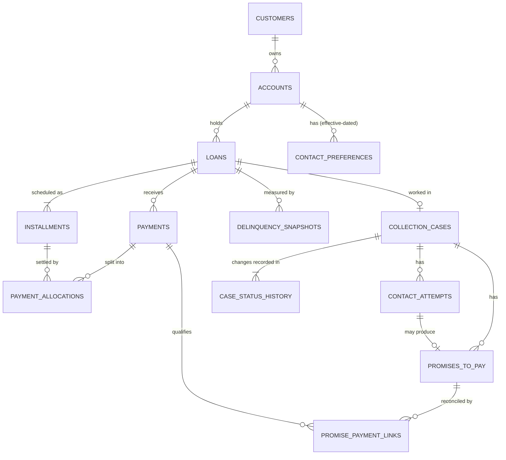
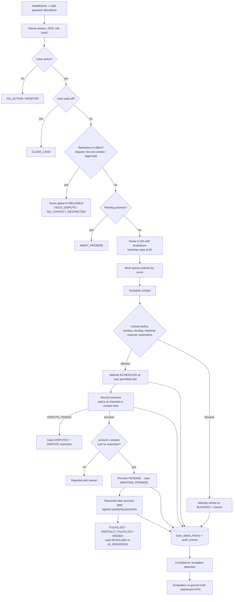

# Loan Collections Management System

Prioritise overdue accounts, schedule contact tasks and monitor promises-to-pay **without aggressive or unlawful
practices**. The solution exposes every decision and exception, keeps a full trail of state changes, and measures
itself against a fixed-seed synthetic dataset with separate ground truth.

**Stack:** Java 21 · Spring Boot 3.5 / Spring MVC (Web, Thymeleaf, Data JPA, JDBC, Security, Validation) · MySQL 8 · Flyway ·
Python 3.10+ (standard library only) for data generation and validation.

> Synthetic data only. Not for real customers or real money.

---

## 1. Requirements coverage

| # | Requirement | Implemented as | Evidence |
|---|---|---|---|
| 1 | Prioritise overdue accounts | Work queue: arrears and DPD derived from installments and valid allocations, then an explainable 0-100 score | `/queue`, `GET /api/v1/work-queue` |
| 2 | Prioritisation is explainable | Stored `score_breakdown` (DPD + balance + risk + broken promises, with cap/gate) and `reason_codes` on every case | Score always equals the sum of its breakdown (validated) |
| 3 | Schedule contact tasks | `ContactService` picks the next permitted slot or a requested time; result stored as a contact attempt | `POST .../contact-attempts`, **Schedule** button |
| 4 | No aggressive or unlawful contact | Hard gates: do-not-contact, legal hold, open dispute, hardship channel limit, customer window, global 08:00-20:00, no Sundays; re-checked when the outcome is recorded | Blocked attempts stored with the reason |
| 5 | Monitor commitments | Promise-to-pay creation with exception paths; reconciliation against later payments; promise-payment links | `POST .../promises`, `POST /api/v1/promises/reconcile` |
| 6 | Promise outcomes match payments | Outcome is derived only from qualifying SUCCEEDED payments between the promise and its date | `promise_outcome_reconciliation` check |
| 7 | Arrears calculations reconcile | Balances recomputed from source records and compared with stored statuses and snapshots | `ARREARS_RECONCILIATION` rule |
| 8 | Expose exceptions | 8 detection rules over all records, for compliance review | `/exceptions`, `GET /api/v1/compliance/exceptions` |
| 9 | Traceability; no overwritten history | Append-only `case_status_history`, `audit_events` for every user action, reversals kept as REVERSED rows, effective-dated preferences | Audit trail records the acting user |
| 10 | Measurable outputs | Dashboard KPIs (promise kept rate, contact block rate, arrears, DPD); precision/recall and decision accuracy against labels | `/`, `/evaluation`, `GET /api/v1/metrics` |
| 11 | Master data first, then dependent events | Generator order: customers → accounts → loans → installments → payments/allocations → snapshots → preferences → cases → contacts → promises | `tools/generate_synthetic_data.py` |
| 12 | 10,000 loans, 30,000 installments over 12 months | 10,000 loans, exactly 30,000 installments (2-4 per loan), originated over 2025-10-28 to 2026-10-28 | `data/generated/manifest.json` |
| 13 | Required scenario coverage | Partial payments, missed promises, disputes, hardship flags, paid-off accounts, contact restrictions (plus failed/reversed payments, legal holds) | Section 6 |
| 14 | Five labelled edge cases | Injected into a valid baseline, 15 of each, labelled in `ground_truth.csv` | Section 6 |
| 15 | Derived values from source records | All balances, statuses, scores and labels come from `tools/collections_rules.py` | Validator recomputes them |
| 16 | Separate ground truth, no leakage | `ground_truth/` folder; not in the seed SQL; read only by the evaluation service | `ground_truth_separated` check |
| 17 | Validation (keys, FKs, enums, dates, arithmetic, lifecycle, duplicates) | `tools/validate_dataset.py`: 69 structural checks and 8 detection rules | `validation_report.json` |
| 18 | Exports | CSV, JSON, MySQL seed SQL, README, data dictionary, manifest (seed, command, SHA-256), validation summary | `data/generated/` |
| 19 | Reproducibility | Fixed seed `20261022`; `check_reproducibility.py` generates twice and compares | 34/34 files byte-identical |
| 20 | ID conventions | `LOAN-2026-000001`, `INS-<loan>-001`, `COL-2026-000001`, `CTP-<case>-001`, `PMT-2026-000001` | `id_convention:*` checks |
| 21 | Actors | Analyst, compliance reviewer and administrator roles; customer represented by data | Section 7 |

---

## 2. Tables

Every table has a surrogate `id BIGINT` primary key and an immutable, unique business reference (`*_ref`).
Money is `DECIMAL(14,2)` (INR). Timestamps are UTC. Full field-level rules (type, required, allowed values,
units, uniqueness, validation) are in [docs/data-dictionary.md](docs/data-dictionary.md).

| Table | Business key | Purpose | Key fields | Rows (default dataset) |
|---|---|---|---|---|
| `customers` | `CUS-2026-NNNNNN` | Account holder (synthetic) | customer_type, risk_grade A-D | 7,806 |
| `accounts` | `ACC-2026-NNNNNN` | Customer relationship | status ACTIVE/CLOSED, opened_at, closed_at | 9,188 |
| `loans` | `LOAN-2026-NNNNNN` | Credit contract | principal, annual rate %, term, start_date, status ACTIVE/PAID_OFF/DEFAULTED | 10,000 |
| `installments` | `INS-<loan>-NNN` | Repayment schedule | number, due_date, principal/interest/fee due, status | 30,000 |
| `payments` | `PMT-2026-NNNNNN` | Money received | amount, received_at, status SUCCEEDED/FAILED/REVERSED, idempotency_key | 25,486 |
| `payment_allocations` | `ALC-<payment>-NN` | **Bridge** payment ↔ installment | amount, status ACTIVE/REVERSED | 26,500 |
| `delinquency_snapshots` | `DS-<loan>-YYYYMMDD` | Month-end and reference-date balance history | days_past_due, arrears_amount, risk_band | 34,104 |
| `contact_preferences` | `CPF-<account>-NN` | Effective-dated channel, window and restrictions | channel, permitted_start/end, timezone, restriction_type | 10,442 |
| `collection_cases` | `COL-2026-NNNNNN` | Collections case per delinquent loan | status, priority_score, priority_band, score_breakdown, reason_codes | 3,879 |
| `case_status_history` | `CSH-<case>-NNN` | Append-only lifecycle events | previous_status, new_status, reason, actor_ref, occurred_at | 22,907 |
| `contact_attempts` | `CTP-<case>-NNN` | Scheduled, executed or blocked contact | channel, scheduled_at, attempted_at, outcome, blocked_reason | 20,071 |
| `promises_to_pay` | `PTP-<case>-NNN` | Customer commitment | promised_amount, promise_date, status, source contact | 5,112 |
| `promise_payment_links` | (promise, payment) | **Bridge** promise ↔ qualifying payment | qualifying_amount | 2,399 |
| `audit_events` | `AUD-<uuid>` | Append-only record of every application action | entity, action, actor, reason, occurred_at | grows with use |

Schema is created by Flyway: `V1__create_core_schema.sql` (tables, foreign keys, checks), `V2__insert_demo_records.sql`
(a small demo record set), `V3__collections_workflow.sql` (risk grade, score breakdown, history refs, extra constraints).

---

## 3. Relationships between tables



| Parent → Child | Cardinality | Foreign key | Notes |
|---|---|---|---|
| customers → accounts | 1 : N | `accounts.customer_id` | ~15% of customers have more than one account |
| accounts → loans | 1 : N | `loans.account_id` | ~8% of loans share an account |
| accounts → contact_preferences | 1 : N | `contact_preferences.account_id` | one base preference plus optional restrictions; `channel` NULL = all channels |
| loans → installments | 1 : N (≥1) | `installments.loan_id` | unique (loan_id, installment_number) |
| loans → payments | 1 : 0..N | `payments.loan_id` | |
| payments ↔ installments | N : M | `payment_allocations.payment_id`, `.installment_id` | oldest-first waterfall; allocation and payment on the same loan |
| loans → delinquency_snapshots | 1 : N | `delinquency_snapshots.loan_id` | unique (loan_id, as_of_date) |
| loans → collection_cases | 1 : 0..1 | `collection_cases.loan_id` | opened when DPD reaches 15 |
| collection_cases → case_status_history | 1 : N (≥1) | `case_status_history.case_id` | first event is OPEN |
| collection_cases → contact_attempts | 1 : 0..N | `contact_attempts.case_id` | |
| collection_cases → promises_to_pay | 1 : 0..N | `promises_to_pay.case_id` | |
| contact_attempts → promises_to_pay | 1 : 0..1 | `promises_to_pay.contact_attempt_id` (optional) | source contact must be on the same case |
| promises_to_pay ↔ payments | N : M | `promise_payment_links.promise_id`, `.payment_id` | composite unique key |

All joins are validated: every FK resolves, allocations stay within one loan, promise links stay within the case's loan.

---

## 4. Business rules (summary)

Implemented identically in Python (`tools/collections_rules.py`) and Java (`domain/`: `CollectionsRules`, `LoanPosition`,
`PriorityScoring`, `ContactPolicy`, `PromiseOutcome`). Full detail is in [docs/business-rules.md](docs/business-rules.md).

| Area | Rule |
|---|---|
| Schedule | Monthly installments, equal-instalment amortisation; last installment absorbs rounding, so principal reconciles exactly |
| Allocation | Only ACTIVE allocations of SUCCEEDED payments count; oldest outstanding installment first |
| Arrears / DPD | At day D: unpaid amount of installments due before D; DPD = days since the oldest such installment |
| Statuses | Installment PAID / PARTIALLY_PAID / OVERDUE / SCHEDULED; loan PAID_OFF / DEFAULTED (DPD ≥ 90) / ACTIVE; account CLOSED when all loans are paid off |
| Risk band | HIGH: DPD ≥ 60, or grade D with DPD ≥ 30 · MEDIUM: DPD ≥ 30, or grade C/D in arrears · else LOW |
| Priority score | DPD ≤ 40 + balance ≤ 30 + risk ≤ 20 + broken promises ≤ 10. Hardship caps the score at 50. Do-not-contact, legal hold or an open dispute → 0 / INELIGIBLE. HIGH ≥ 60, MEDIUM ≥ 30 |
| Contact policy | A base preference must exist (fail closed); no blocking restriction; EMAIL instead of PHONE/SMS during hardship; inside the customer window and 08:00-20:00 local time; never on Sunday |
| Case lifecycle | OPEN → IN_PROGRESS → AWAITING_PROMISE / DISPUTED / RESOLVED → CLOSED; CLOSED is terminal; every other transition is rejected |
| Promise | Only on OPEN/IN_PROGRESS cases with no restriction; amount ≤ current arrears; due within 30 days. FULFILLED / PENDING / PARTIALLY_FULFILLED / MISSED from qualifying payments |
| Next action | CLOSE_CASE, MONITOR, RESOLVE_CASE, HOLD_DISPUTE, NO_CONTACT_RESTRICTED, AWAIT_PROMISE, CONTACT_HARDSHIP_SUPPORT, SCHEDULE_CONTACT, NO_ACTION |

---

## 5. Flow



Step by step:

1. **Load data.** The administrator loads the generated dataset (`/evaluation` → *Load synthetic dataset*). It replaces all business tables.
2. **Prioritise.** The analyst opens `/queue`. Contactable cases come first, ordered by score; each row shows the
   breakdown, reason codes, next action, channel and next permitted slot. Filter by action.
3. **Schedule.** *Schedule* creates a contact attempt at the next permitted slot, or a BLOCKED attempt with its reason.
4. **Record outcome.** The policy is re-checked at contact time. `DISPUTE_RAISED` moves the case to DISPUTED and
   adds a DISPUTE restriction from the next day, so no further collection contact happens.
5. **Take a promise.** It is rejected if it exceeds arrears, the account is restricted, or the case is not
   contactable. Otherwise the case moves to AWAITING_PROMISE.
6. **Monitor commitments.** *Reconcile promises* settles promises past their date, writes payment links and moves
   the case to RESOLVED (arrears cleared) or back to IN_PROGRESS.
7. **Compliance review.** `/exceptions` lists every rule breach with severity and detail.
8. **Measure.** The dashboard shows KPIs; `/evaluation` scores detection and decisions against the ground truth.

Every step writes explicit records (attempts, promises, links, history, audit events). Nothing is overwritten
without a corresponding history or audit row.

---

## 6. Synthetic dataset, edge cases and results

```powershell
python tools/generate_synthetic_data.py [--loans 10000] [--seed 20261022] [--reference-date 2026-10-28] [--out data/generated]
python tools/validate_dataset.py         # re-validate an export from its CSVs only
python tools/check_reproducibility.py    # two runs, compare row counts + SHA-256
```

Use `--loans 100` for a starter set; it comes from the same generator. Output in `data/generated/`: `csv/`,
`json/`, `sql/seed.sql`, `ground_truth/`, `validation_report.json`, `manifest.json`, `README.md`,
`data_dictionary.md`.

**Coverage in the default dataset**

| Scenario | Count |
|---|---|
| Paid-off loans / defaulted (DPD ≥ 90) / active | 6,717 / 1,057 / 2,226 |
| Partially paid installments · overdue installments | 737 · 2,662 |
| Failed / reversed payments | 614 / 179 |
| Promises fulfilled / missed / partially fulfilled / pending | 2,039 / 2,710 / 263 / 100 |
| Disputes raised · hardship arrangements · do-not-contact · legal holds | 471 · 458 · 243 · 82 |
| Contacts blocked by policy | 229 |

**Labelled edge cases** (15 each in `ground_truth/ground_truth.csv`, with the rule(s) each one breaks):

| Edge case | How it is injected | Detected by rule(s) | Expected decision |
|---|---|---|---|
| Paid account remains in collection | Closed case of a paid-off loan moved back to IN_PROGRESS | `PAID_ACCOUNT_IN_COLLECTION`, `INVALID_CASE_TRANSITION` | CLOSE_CASE |
| Contact outside allowed window | Executed attempt moved to 06:xx or 21:xx local time | `CONTACT_OUTSIDE_WINDOW` | BLOCK_AND_REVIEW |
| Payment allocated to wrong installment | Latest allocation moved to a not-yet-due installment while an earlier one is outstanding | `WRONG_INSTALLMENT_ALLOCATION`, `ARREARS_RECONCILIATION` | REALLOCATE_OLDEST_FIRST |
| Promise amount exceeds arrears | Promised amount set to 1.3-2× arrears at creation | `PROMISE_EXCEEDS_ARREARS` | REVIEW_PROMISE |
| Disputed debt treated as confirmed | Case moved out of DISPUTED while the dispute is open, then contacted | `DISPUTED_TREATED_AS_CONFIRMED`, `CONTACT_DURING_RESTRICTION` | HOLD_DISPUTE |

`ground_truth/expected_case_decisions.csv` also labels the expected next action and priority band for every case.

**Results**

| Check | Result |
|---|---|
| Structural validation (keys, FKs, ID formats, enums, date order, arithmetic, duplicates, joins, lifecycle, promise reconciliation, explainability, ground-truth separation) | 69 / 69 pass |
| Python rule detection vs. ground truth | 8 rules, 0 false positives, 0 false negatives |
| Java application detection vs. ground truth (`/evaluation`) | 8 rules, precision 1.0, recall 1.0 |
| Java next action / priority band vs. labels | 3,879 / 3,879 cases (100%) |
| Reproducibility (two runs, same seed) | 34 / 34 files byte-identical, identical row counts |

---

## 7. Security

Implemented for development; see the limitations below.

| Item | Implementation |
|---|---|
| Authentication | HTTP Basic (`SecurityConfig`), BCrypt-hashed in-memory users |
| Authorisation | Role-based URL rules; everything except `/api/v1/health` and static CSS requires login |
| Roles = actors | **ANALYST** (operations analyst) · **COMPLIANCE** (risk/compliance reviewer) · **ADMIN** (system administrator). The customer/account holder is represented by data (preferences, restrictions, disputes, payments) |
| Write protection | All POST requests need ANALYST or ADMIN, so compliance is read-only |
| Compliance data | `/exceptions`, `/api/v1/compliance/**` need COMPLIANCE or ADMIN |
| Admin functions | `/evaluation`, `/admin/**`, `/api/v1/admin/**` (dataset load, evaluation) need ADMIN |
| Traceability | Acting username stored as `actor_ref` on contacts, promises and history, and in `audit_events` |
| Policy gates | Contact restrictions are enforced server-side before scheduling and again when the outcome is recorded; they fail closed |
| Input validation | Bean Validation on request bodies; business rule violations return HTTP 400 with a message; unknown errors return a generic 500 |
| Data protection | Synthetic data only; DTOs instead of entities in the API; DB credentials in the git-ignored `.env` |

| User | Password | Role |
|---|---|---|
| `analyst` | `dev-analyst-change-me` | ANALYST |
| `compliance` | `dev-compliance-change-me` | COMPLIANCE |
| `admin` | `dev-admin-change-me` | ADMIN |

**Not production-ready:** users are in memory and the passwords are fixed; CSRF protection is disabled; there is
no TLS, rate limiting, account lockout or least-privilege DB user. Replace with an identity provider and these
controls before any shared deployment.

---

## 8. Running it

Requirements: Java 21, MySQL 8, Python 3.10+. Maven is not needed; the project includes the wrapper.

```powershell
Copy-Item .env.example .env        # set DB_USERNAME / DB_PASSWORD (imported automatically)
python tools/generate_synthetic_data.py
.\mvnw.cmd clean test              # 21 unit tests
.\mvnw.cmd spring-boot:run         # http://localhost:2000 (Flyway creates the schema)
```

Sign in as `admin`, open **Evaluation**, then click **Load synthetic dataset**. Alternatively:
`mysql -u root -p loan_collections < data/generated/sql/seed.sql`.

**Pages:** `/` dashboard · `/queue` work queue · `/loans` · `/loans/new` · `/cases` · `/exceptions` · `/evaluation`

**REST API** (JSON envelope `{success, data, message, timestamp}`; `asOf` defaults to today in UTC; dataset reference date 2026-10-28)

| Method | Path | Role |
|---|---|---|
| GET | `/api/v1/health` | public |
| GET | `/api/v1/work-queue?asOf=&limit=` | any |
| GET | `/api/v1/collection-cases/{caseRef}/assessment?asOf=` | any |
| POST | `/api/v1/collection-cases/{caseRef}/contact-attempts` `{"requestedAt"?}` | analyst |
| POST | `/api/v1/contact-attempts/{contactRef}/outcome` `{"outcome","attemptedAt"?}` | analyst |
| POST | `/api/v1/collection-cases/{caseRef}/promises` `{"amount","promiseDate","contactRef"?}` | analyst |
| POST | `/api/v1/promises/reconcile?asOf=` | analyst |
| GET | `/api/v1/metrics?asOf=` | any |
| GET | `/api/v1/compliance/exceptions?asOf=&rule=` | compliance, admin |
| GET | `/api/v1/admin/evaluation` | admin |
| POST | `/api/v1/admin/seed` | admin |
| GET / POST | `/api/v1/loans`, `/api/v1/loans/{loanRef}`, `/api/v1/collection-cases[/{caseRef}]` | any / analyst |

**Unit tests** (`src/test`): priority scoring, contact policy (windows, restrictions, hardship, fail-closed, next
slot), promise reconciliation, loan position and lifecycle rules, arrears/DPD calculation.

---

## 9. Project layout

Standard layered Spring MVC structure. Package rules and conventions are in [docs/architecture.md](docs/architecture.md).

```text
src/main/java/com/example/loancollections/
├── LoanCollectionsApplication.java
├── config/              SecurityConfig, AppProperties (@ConfigurationProperties "app")
├── controller/
│   ├── api/             REST controllers, one per resource (/api/v1/**)
│   │                    Health, Loan, CollectionCase, WorkQueue, Contact, Promise, Compliance, Admin
│   └── web/             Thymeleaf page controllers
│                        Dashboard, WorkQueue, Loan, CollectionCase, Compliance, Admin
├── service/             service interfaces (business contracts)
│   └── impl/            implementations: transactions and orchestration, no SQL
├── repository/          Spring Data JPA (LoanRepository, CollectionCaseRepository)
│   └── jdbc/            JdbcTemplate repositories (all SQL lives here)
├── domain/              pure business rules: CollectionsRules, LoanPosition, DelinquencyCalculator,
│                        PriorityScoring, ContactPolicy, PromiseOutcome, CollectionsData (read model)
├── model/
│   ├── entity/          JPA entities (Loan, CollectionCase)
│   └── dto/
│       ├── request/     request bodies and forms (Bean Validation)
│       └── response/    ApiResponse envelope and response DTOs
├── exception/           BusinessException, ResourceNotFoundException, GlobalExceptionHandler
└── util/                DateUtils
src/main/resources/
├── application.yml      imports the git-ignored .env
├── db/migration/        V1 schema, V2 demo rows, V3 workflow columns/constraints
├── templates/           fragments/layout.html, dashboard/, queue/, loans/, cases/, compliance/, admin/
└── static/css/
src/test/java/.../domain/   unit tests for the domain rules
tools/                   collections_rules.py, generate_synthetic_data.py, validate_dataset.py, check_reproducibility.py
docs/                    architecture.md, business-rules.md, data-dictionary.md
data/generated/          generated dataset (reproducible from the seed)
```

## 10. Known limitations
- The synthetic baseline raises disputes only on single-loan accounts (restrictions are account-level).
- Some installments fall due after the reference date because loans originate across the whole 12-month window.
- Promise reconciliation runs on demand (button or API), not on a schedule.
- Contact execution is recorded, not performed: no telephony, SMS or email integration.
